<p align="center">
  
</p>

# L-qNeumann v0.1

**面向「权重即主板」的系统化推理 · 基于 llama.cpp 与 ggml 的电路执行器 · 让冯诺依曼机在 Qwen3.5-4B 的权重里跑起来并跑快**

> 状态：**v0.1 开发版**（M1–M4 已完成，M5 端到端待做）
> 更新日期：2026-11-23
> 适用范围：电路侧推理引擎的定位、能力、基线、约束与文档索引。
> 机制归 [`docs/design/ARCHITECTURE.md`](docs/design/ARCHITECTURE.md)，谱系归
> [`docs/design/LINEAGE.md`](docs/design/LINEAGE.md)，边界归
> [`docs/limits/ENGINE-LIMITS.md`](docs/limits/ENGINE-LIMITS.md)，可压缩性的边界归
> [`docs/limits/WEIGHT-ENTROPY.md`](docs/limits/WEIGHT-ENTROPY.md)，实测口径归
> [`docs/measure/BASELINES.md`](docs/measure/BASELINES.md)，里程碑归
> [`docs/measure/MILESTONES.md`](docs/measure/MILESTONES.md)。

L-qNeumann 把 QwenPU 这套「CPU 编译进 LLM 权重」的模型**当成一台机器来跑**：13 层电路是 CPU、
1 层 kernel 是加速器、32 层 Qwen 是语言层，token 流是总线，DeltaNet 状态是内存。它不是把模型
当黑盒调 API，而是**接管前向的每一步**，因此能对「这台机器跑多快」负责。

## 与上游三个项目的关系

| 项目 | 角色 | 我们的关系 |
|---|---|---|
| [**qwenputer**](https://github.com/divagr18/qwenputer) | 上游总项目：把一台计算机编译进 Qwen3.5 的权重 | **上游概念来源**，不直接改 |
| [**QwenPU**](https://github.com/divagr18/QwenPU) | 上游子项目：Qwen3.5-4B + 32 位 RISC-V CPU + 向量单元 | **fork 并深度魔改**——本项目的 qwenpu/ 是它的衍生 |
| [**torchwright**](https://github.com/divagr18/torchwright) | 编译器：把计算图变成 transformer 权重 | **使用并扩展**——P2b/P3 的状态机能力是本项目加的 |

**一句话**：L-qNeumann = 魔改后的 QwenPU（电路 + kernel 插槽 + 记录压缩 + 访存优化）+ torchwright 的状态机能力 + 一个新的推理引擎（本项目的 `engine/`）。

**与标准 QwenPU 的关键差异**（这些不是上游能力，是本项目加的）：

| 改动 | 位置 | 效果 |
|---|---|---|
| **overlay 列复用** | `q35/overlay.py` | columns 5119 → 4374（−14.6%） |
| **O1 瘦身** | merge `--hidden 4608 --ballast 18` | checkpoint 24.89 → 22.40 GiB |
| **KERNEL 插槽（K0/K1）** | `q35/kernel.py` | 第 13 层，80 列，1 token 走完 DAG |
| **SB/SH 记录压缩** | `rv/{spec,ref,core}.py` | 4 token → 2 token，sieve −18.8% |
| **chip token 连续性** | `rv/{fastexec,fusedexec,chat}.py` | 一次 `run(k)`，2.31× |
| **head 拆 CTA + 跨 CTA 归并** | `rv/fusedexec.py` | chip 步 267.4 → 204.5 μs（1.307×） |
| **状态机（P3）** | torchwright | 完整 Gated DeltaNet（权重通道 / ONNX 读侧 / Loop prefill） |

## 基线（v0.1 起跑线）

**两条路的数字不能互算**：Triton 量「电路本身能跑多快」，llama.cpp 量「通用引擎跑同一段电路的
端到端步进」。口径见 [BASELINES](docs/measure/BASELINES.md)。

| 路线 | 项 | 数字 |
|---|---|---:|
| **Triton v1** | chip 步（生产路径，B=1） | **204.5 μs** |
| Triton v1 | chip 步累计（从 830.6 起） | **4.06×** |
| **llama.cpp** | chip 段 0–13 步进（dense GPU） | **26.48 ms** |
| **llama.cpp** | chip 段步进（稀疏 store） | **3.40 ms**（同轮对照；次日同配置测到 **1.65 ms**，GPU 降频差异） |
| llama.cpp | 46 层 + 全量头（CPU，单 token） | 380 ms |
| llama.cpp | 生产 GGUF | **7.663 GiB**（窄头 + 稀疏 store + 程序化 embedding） |
| 电路 | calc `4+3` | **326 token**（官方 767） |
| 电路 | 语言能力 | = Qwen3.5-4B（32 层 Qwen 未动） |

## 这个引擎在做什么

**一句话：把 chip 步从「读 5.30 GiB 权重」变成「读 8.30 MiB 的非零」，再往上压引擎税。**

在 Triton 单实现上，瓶颈是随机访存而不是算力：

```
chip 步 204.5 μs
├─ 访存（gather）  85%   ← 真瓶颈
├─ 归约/argmax      9%
├─ atomic           1%
└─ 真正的计算     0.07%   ← 算力几乎没用上
```

每次乘加要配 4 次随机读，而 GPU 的随机读吞吐只有算力的 1/41。**不是算得慢，是搬数据慢。**

在 llama.cpp 上，这条诊断把方向定成了**稀疏执行**而不是手搓 kernel：

| 阶段 | chip 步 | 瓶颈 |
|---|---:|---|
| dense，14 层 | 26.48 ms | **权重带宽**（4.92 GiB 读一遍） |
| 稀疏 store，14 层 | **3.40 ms** | **建图/调度/launch**（每层约 15 个节点） |

**5.30 GiB 权重里 99.96% 是零，只有 8.30 MiB 是非零。** 稀疏化之后，剩下的时间不再由数据量决定，
而由「每层要发多少个 op」决定——所以下一步是融合 sublayer，不是继续抠存储。

## 快速开始

```bash
# 1. 测试电路（内存验证，不写盘）
cd qwenpu && python -m pytest tests/test_rv_ref.py tests/test_rv_core.py -q

# 2. 跑 chip 步基线（Triton 口径）
python -m chipformer.rv.fusedexec --timed3    # 或见 docs/deploy/BUILD.md

# 3. 合并 checkpoint（产物 22.87 GiB，46 层）
python -m chipformer.rv.merge ... --vx --overlay --hidden 4608 --ballast 18 \
  --kernel k0_kernel.npz --no-mute

# 4. 量化 + 稀疏化（产物 7.663 GiB，生产形态）
#    见 docs/deploy/BUILD.md §四/§七
```

**环境**：Windows + WSL(Ubuntu-22.04) + Python 3.12 + torch 2.13+cu126 + RTX 4060 Laptop 8 GB。
riscv 工具链用 `wsl_build_calc.sh` 一键搭（见 `docs/deploy/BUILD.md`）。

## 文档索引

| 想知道 | 看 |
|---|---|
| **立项论证：QwenPU 是什么、卡在哪、我们补什么** | [`docs/design/PROPOSAL.md`](docs/design/PROPOSAL.md) |
| 这台机器怎么组成（四维资源：列 × 层 × 时间 × 状态） | [`docs/design/ARCHITECTURE.md`](docs/design/ARCHITECTURE.md) |
| **token 流为什么不能「双关」**（信息论边界） | [`docs/design/TOKEN-ENCODING.md`](docs/design/TOKEN-ENCODING.md) |
| 训练桥（LoRA）能加在哪、值不值得做 | [`docs/design/BRIDGE-LORA.md`](docs/design/BRIDGE-LORA.md) |
| 视觉塔能做什么（rv1 里没有它） | [`docs/design/VISION-TOWER.md`](docs/design/VISION-TOWER.md) |
| 和 qwenputer / QwenPU / torchwright 什么关系 | [`docs/design/LINEAGE.md`](docs/design/LINEAGE.md) |
| 引擎的能力边界与架构代价（为什么慢 6 个数量级） | [`docs/limits/ENGINE-LIMITS.md`](docs/limits/ENGINE-LIMITS.md) |
| **权重为什么能压 619 倍、训练层为什么不能**（三种熵） | [`docs/limits/WEIGHT-ENTROPY.md`](docs/limits/WEIGHT-ENTROPY.md) |
| 所有实测数字与口径 | [`docs/measure/BASELINES.md`](docs/measure/BASELINES.md) |
| **M1–M4 每个里程碑的结论与判据** | [`docs/measure/MILESTONES.md`](docs/measure/MILESTONES.md) |
| 怎么构建、怎么跑 | [`docs/deploy/BUILD.md`](docs/deploy/BUILD.md) |
| 引擎本体 | [`engine/`](engine/) |
| 电路定义与黄金参考（纯 Python） | [`circuit/`](circuit/) |
| 验收装置 | [`verify/`](verify/) |
| 归档的 Triton 实现（性能基线） | [`_reference/`](_reference/) |
